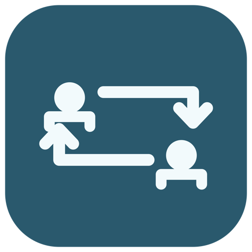
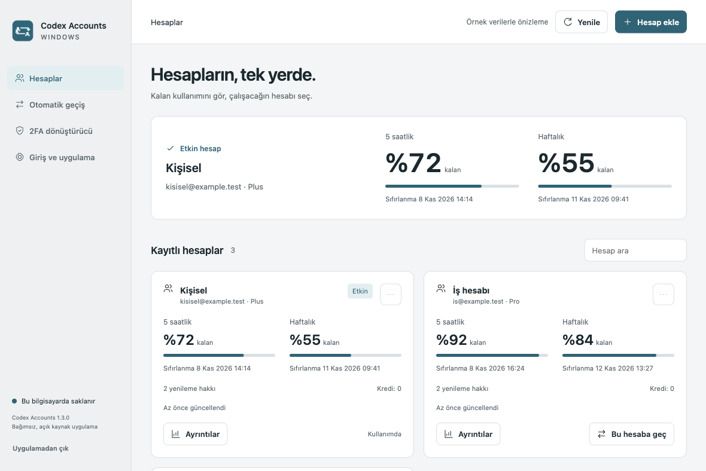
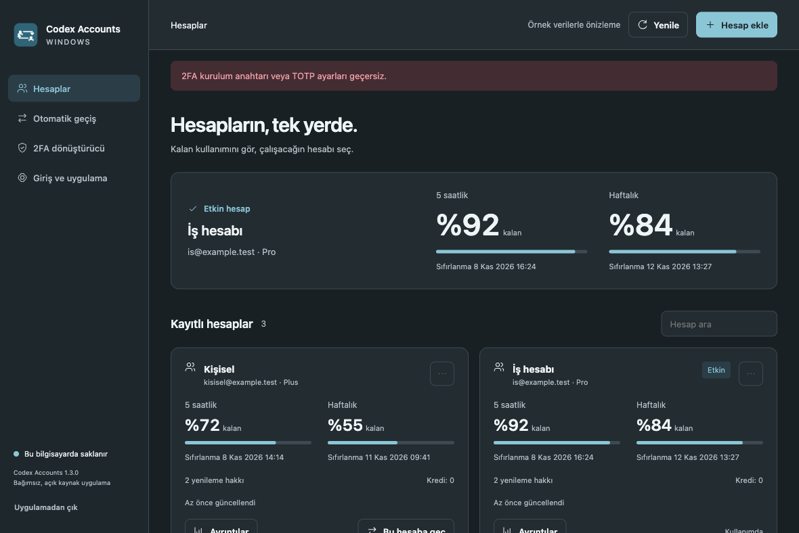
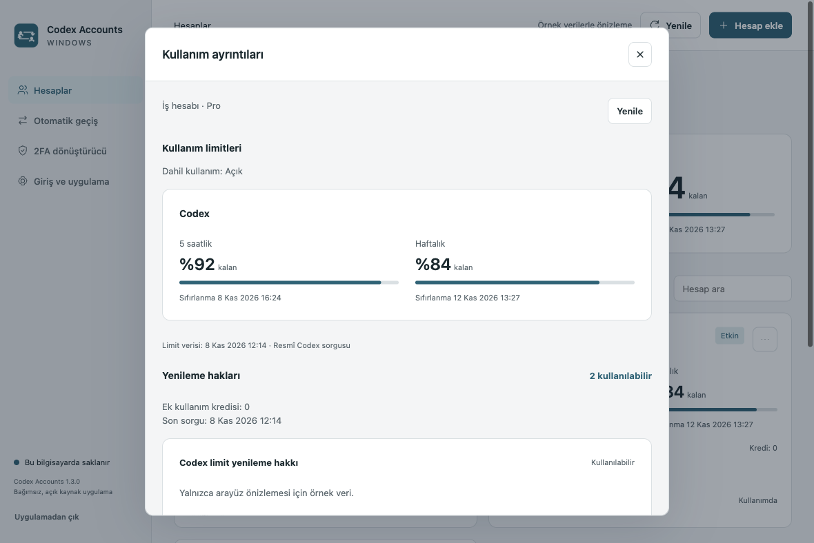
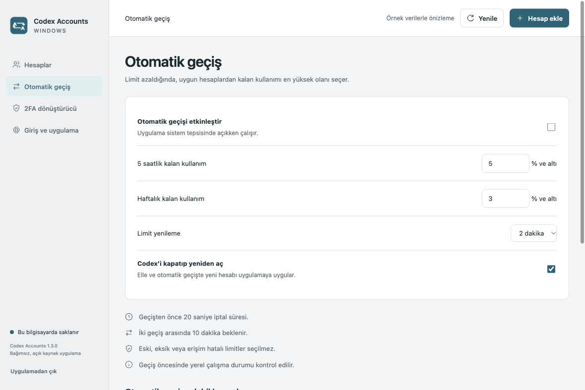
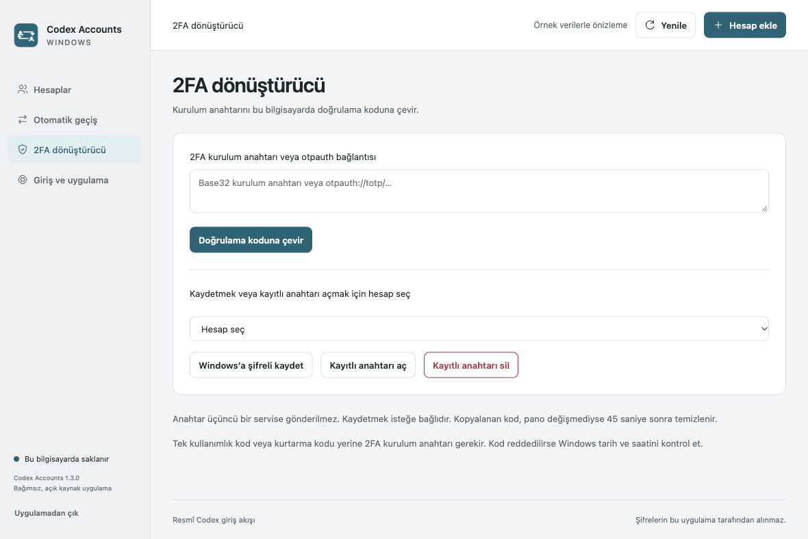
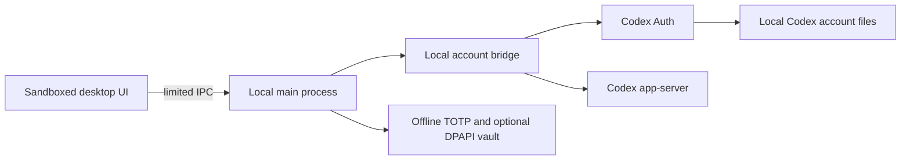

<div align="center">
  
  <h1>Codex Accounts Switcher</h1>
  <p><strong>Your Codex accounts. One desktop companion.</strong></p>
  <p>Open-source Windows account manager for switching Codex accounts, checking usage limits and generating offline 2FA codes.</p>
  <p>
    <a href="https://github.com/hasansercan/codex-accounts-switcher/releases/latest"></a>
    <a href="https://github.com/hasansercan/codex-accounts-switcher/actions/workflows/ci.yml"></a>
    <a href="LICENSE"></a>
    
  </p>
  <p><a href="https://github.com/hasansercan/codex-accounts-switcher/releases/latest"><strong>Download for Windows</strong></a> · <a href="README.tr.md">Türkçe</a> · <a href="docs/INSTALLATION.md">Installation guide</a> · <a href="docs/VERIFICATION.md">What has been tested</a></p>
</div>



*Screenshots show synthetic demo accounts, not personal accounts. The current interface is in Turkish; English documentation is included.*

## Why use it?

If you already use separate personal, work or education Codex accounts, this desktop companion keeps their status in one place. Check the remaining short-term and weekly allowance, inspect token history when the server provides it, and choose the account for your next session.

**Independent community software. Not affiliated with, endorsed by or published by OpenAI.** Use only accounts you are authorized to access. Workspace restrictions and subscription limits still apply.

## Features

| Feature | What it does |
| --- | --- |
| Multi-account manager | Add accounts through the official browser/device-code sign-in flow, set aliases and switch the active account. |
| Usage dashboard | Show remaining allowance, reset times, model buckets and cached-data freshness. Missing information stays unknown. |
| Usage details | Display reset-credit availability, additional credits and daily token history when supplied by Codex app-server. Does not redeem reset credits. |
| Optional automatic switching | Disabled by default. Fresh complete limits, account exclusions, explicit institution opt-in, 20-second notice, snooze and cooldown. |
| Offline TOTP | Base32 / otpauth, SHA-1/256/512, 6/8 digits. Optional Windows DPAPI-encrypted storage and clipboard cleanup. |
| Desktop integration | Tray menu, Windows startup preference, light/dark/system appearance and manual subscription-date reminders. |
| Graceful Codex restart | Optional normal window close before switching. Aborts if closing is refused; recent activity can defer the switch. |

<details>
<summary><strong>More screenshots</strong></summary>

### Dark appearance


### Usage details


### Automatic switching preferences


### Offline 2FA converter


</details>

## Install in a minute

1. Open **[the latest release](https://github.com/hasansercan/codex-accounts-switcher/releases/latest)**.
2. Download `Codex-Accounts-1.3.0-Windows-x64-Setup.exe`.
3. Run it. It installs for your Windows user, creates Desktop/Start menu shortcuts and opens the app. No administrator rights, terminal, Node.js or separate Codex CLI installation required.
4. Select **Hesap ekle** (Add account), complete sign-in in Chrome/Edge, then select **Bu hesaba geç** (Switch to this account).

The publisher is not digitally signed, so Windows may display a SmartScreen notice. Verify the source and the SHA-256 checksum before running. Do not disable system-wide security protections.

**Portable option:** download the Windows x64 ZIP, extract the entire folder, then run `Codex Accounts.exe`. Keep the adjacent files. Application data is still stored in AppData, not alongside the EXE.

**Upgrade:** quit from the tray menu and run the new installer over the existing installation. No account re-entry is needed for an existing Windows installation. Uninstalling preserves account files and app preferences; see [data locations](docs/PRIVACY.md).

**Requirements:** Windows 10/11, Intel/AMD x64; internet for sign-in/live usage; Chrome or Edge for an isolated login window. You can instead copy the login link into your browser on the same computer. This release does not include a macOS, Linux, ARM64 or 32-bit distribution.

## Build from source

Install Node.js **24 or later**, npm, and **NSIS 3** (`makensis` on PATH). On macOS, `brew install nsis`; on Windows, install NSIS and open a fresh terminal. The build script also detects its default Program Files location.

```sh
git clone https://github.com/hasansercan/codex-accounts-switcher.git
cd codex-accounts-switcher
npm ci
npm run setup:electron
npm test
npm run build:win
```

Artifacts in `dist/`:

- `Codex-Accounts-1.3.0-Windows-x64-Setup.exe` — per-user automatic installer and uninstaller.
- `Codex-Accounts-1.3.0-Windows-x64.zip` — complete portable application.
- `Codex-Accounts-1.3.0-Windows-Source.zip` — source-only package.
- `SHA256SUMS.txt` — checksums for the downloads.

The build downloads pinned Codex Auth **0.3.1** and Codex CLI **0.162.0**, verifies npm SHA-512 integrity, and includes them with Electron **45.2.3**. Electron download checksums are verified by the Electron tooling. Build tools do not become runtime npm dependencies. There is no paid component or API key requirement for this account manager.

For a safe UI preview with synthetic accounts:

```sh
npm run demo
```

Demo mode does not start the real account bridge. macOS/Linux are supported only for development preview and cross-packaging in this repository. Actual account operations target Windows.

## How it works



The renderer has no Node integration or unrestricted IPC. Passwords are entered on the provider's website. Codex auth tokens are not passed to the renderer. See [security](SECURITY.md), [privacy and storage](docs/PRIVACY.md) and [third-party notices](THIRD_PARTY_NOTICES.md).

## Status and limitations

This is a **community preview release**. Automated policy, mapping, TOTP and mocked bridge tests, packaging checks and demo UI verification are documented in [VERIFICATION.md](docs/VERIFICATION.md). They do not prove that real OAuth/SSO, DPAPI, native Codex restart or every Windows setup works.

The previous 1.2.1 Windows package was reported to open, but its restart helper used an ASAR path that PowerShell could not read. The physical-helper fix is retained here, with regression checks for both inspect and close. Live native Codex compatibility still needs user testing. Existing CLI sessions do not automatically change accounts. Activity detection is based on local session logs and can be incomplete. Subscription dates are manually entered reminders, not billing data. Server-side endpoint changes can make some usage fields unavailable.

If anything fails, use the [troubleshooting guide](docs/INSTALLATION.md#troubleshooting) and [open a sanitized issue](https://github.com/hasansercan/codex-accounts-switcher/issues/new/choose). Never attach auth files, login links, passwords, 2FA secrets or unredacted account exports.

## Contribute and support

Bug reports, accessibility improvements, translations and real Windows test reports are welcome. Read [CONTRIBUTING.md](CONTRIBUTING.md). If the app is useful, star the repository or share its release page.

Created by **[Hasan Sercan](https://github.com/hasansercan)**. Application source is [MIT licensed](LICENSE); bundled dependencies retain their licenses. Account switching uses [Loongphy/codex-auth](https://github.com/Loongphy/codex-auth); usage/sign-in use the [official Codex app-server interface](https://learn.chatgpt.com/docs/app-server).
