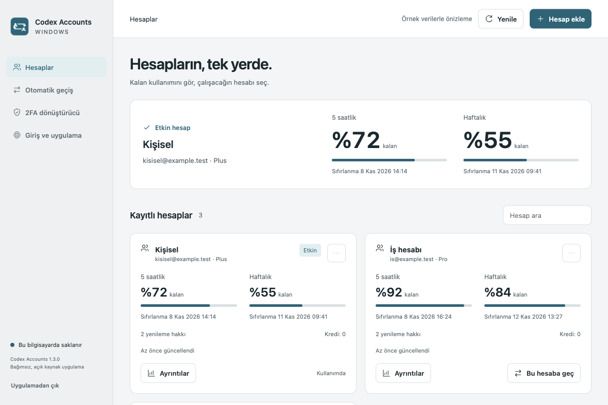

# Codex Accounts Switcher

**Codex hesapların, tek masaüstü uygulamasında.** Windows için açık kaynak hesap yöneticisi: hesap geçişi, kullanım limitleri, günlük token geçmişi ve çevrimdışı 2FA.

[Windows sürümünü indir](https://github.com/hasansercan/codex-accounts-switcher/releases/latest) · [English](README.md) · [Kurulum ayrıntıları](docs/INSTALLATION.md)



Görseller örnek hesaplarla alınmıştır. Uygulamanın arayüzü Türkçedir. OpenAI tarafından yayımlanmış veya onaylanmış bir ürün değildir.

## Neler yapar?

- Kişisel, iş ve yetkili olduğun kurum hesaplarını resmî giriş üzerinden ekleme; takma ad verme ve hesap değiştirme.
- 5 saatlik/haftalık limitleri, sıfırlanma zamanlarını ve sunucunun sağladığı model gruplarını görüntüleme.
- Yenileme hakları, ek kullanım kredisi ve günlük token geçmişi. Eksik bilgi sıfır sayılmaz; hak harcama işlemi uygulanmaz.
- İsteğe bağlı otomatik geçiş: varsayılan kapalı, güncel limit kontrolü, kurum hesabı onayı, 20 saniye ön bildirim, 30 dakika erteleme ve bekleme süresi.
- Çevrimdışı 2FA kodları; isteğe bağlı Windows DPAPI ile şifreli saklama. Kodu kopyalama ve ekrandan temizleme.
- Sistem tepsisi, Windows açılışında başlatma, açık/koyu tema ve elle Plus tarih takibi.

## Otomatik kurulum

1. [Releases sayfasından](https://github.com/hasansercan/codex-accounts-switcher/releases/latest) `Codex-Accounts-1.3.0-Windows-x64-Setup.exe` dosyasını indir.
2. Çift tıkla. Yönetici yetkisi veya terminal gerekmez; program ve kısayollar kurulur.
3. **Hesap ekle** ile giriş yap. Ardından **Bu hesaba geç** seç.

Windows 10/11 Intel/AMD x64 hedeflenir. Ayrı Node.js veya Codex CLI gerekmez. Ayrı giriş penceresi Chrome/Edge kullanır. İstersen otomatik açmayı kapatıp bağlantıyı aynı bilgisayardaki tarayıcıya kopyala. Kurum SSO için tarayıcı akışını tercih et.

Paket dijital yayıncı sertifikasıyla imzalanmamıştır; SmartScreen uyarısı çıkabilir. Dosyanın kaynağını ve SHA-256 değerini doğrula. Sistem güvenliğini genel olarak kapatma.

**ZIP seçeneği:** ZIP’in tamamını çıkar, içindeki `Codex Accounts.exe` dosyasını aç; yanındaki dosyaları koru. **Güncelleme:** uygulamayı tepsiden Çık ile kapatıp yeni kurulumu üstüne çalıştır. Önce kaldırmak gerekmez. Hesapların ve ayarların korunur.

## Mac sürümü

Apple Silicon (M serisi), macOS 13.5 ve üzeri için yerel SwiftUI paketi var. Releases sayfasından macOS arm64 ZIP dosyasını indirip çıkar ve uygulamayı Uygulamalar klasörüne taşı. Paket ad-hoc imzalıdır ve Apple noter onayı yoktur. [Mac kurulum ve derleme rehberi](macos/README.md).

## Kaynaktan derleme

Node.js 24+, npm ve NSIS 3 (`makensis`) gerekir:

```sh
git clone https://github.com/hasansercan/codex-accounts-switcher.git
cd codex-accounts-switcher
npm ci
npm run setup:electron
npm test
npm run build:win
```

Kurulum EXE’si, taşınabilir ZIP, kaynak ZIP ve `SHA256SUMS.txt` dosyası `dist/` altında oluşur. `npm run demo` gerçek hesaplara dokunmadan örnek arayüzü açar.

## Doğrulama durumu

Bu sürüm topluluk önizlemesidir. [Doğrulama kaydı](docs/VERIFICATION.md), otomatik testlerle gerçek Windows hesabı testlerini ayırır. Gerçek Windows giriş/SSO, DPAPI ve native Codex’in hesap değişimini uygulaması henüz uçtan uca doğrulanmış değildir. Açık CLI oturumları kendiliğinden yeni hesaba geçmez. Kurum erişim kısıtları uygulanır.

Hesaplar `.codex` altında, tercihler ve isteğe bağlı şifreli 2FA kasası `%APPDATA%\Codex Accounts` altında tutulur. [Gizlilik ve veri yolları](docs/PRIVACY.md). Kaldırıcı kişisel hesap/ayar verilerini silmez.

Geliştiren: **[Hasan Sercan](https://github.com/hasansercan)**. MIT lisanslı uygulama; bağımlılıklar kendi lisanslarını korur. Faydalı bulursan depoya yıldız vererek veya bağlantısını paylaşarak destek olabilirsin.

## Geliştirici hakkında

**Hasan Sercan**
Full Stack Software Engineer · Deca Yazılım Kurucusu

İşletmeler için özel yazılım, web ve mobil uygulamalar, SaaS ürünleri ve sistem entegrasyonları geliştiriyorum.

[Portföy ve hizmetler](https://hasansercan.com.tr/) · [Projenizi konuşalım](https://hasansercan.com.tr/contact)
